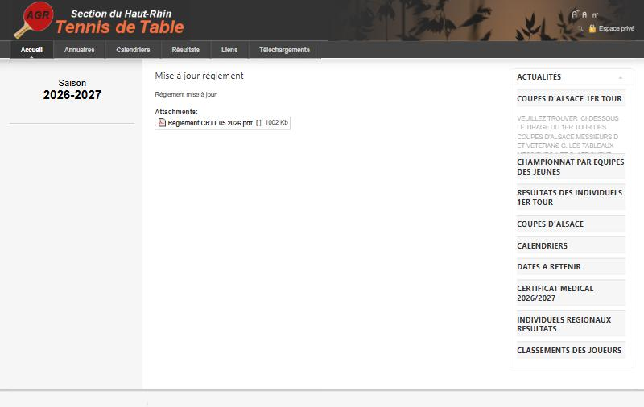
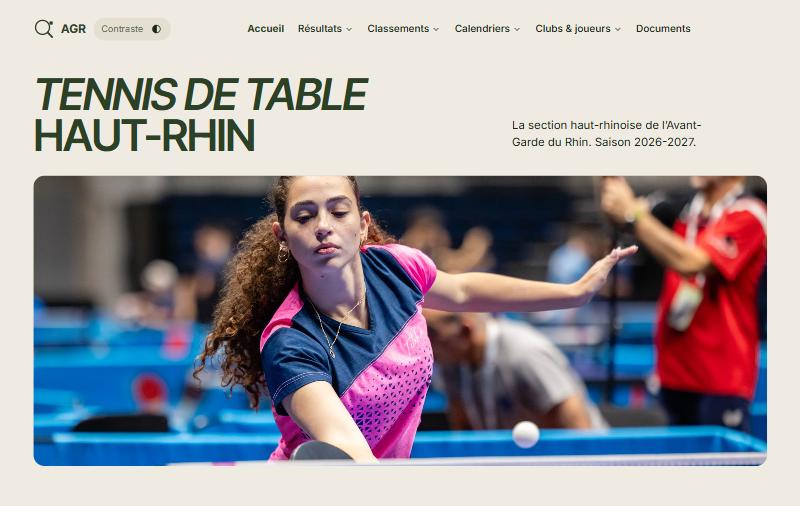
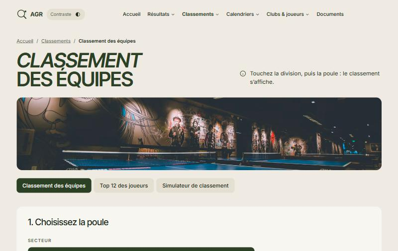
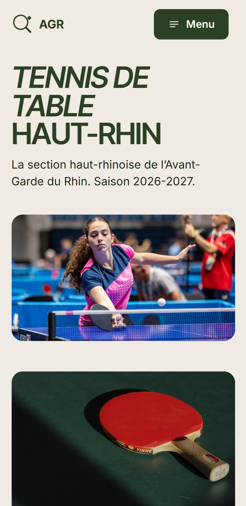

# Refonte du site de l'AGR Tennis de Table du Haut-Rhin

Proposition de refonte graphique et ergonomique du site [agr-tt.fr/agrtt68](https://www.agr-tt.fr/agrtt68/), qui publie les calendriers, résultats et classements du tennis de table haut-rhinois. L'information y est complète mais difficile à trouver, surtout sur téléphone et pour des visiteurs peu à l'aise avec l'informatique.

| Avant | Après |
|---|---|
|  |  |

Projet personnel, réalisé seul en octobre 2026, de ma propre initiative, puis proposé au responsable du site. **Ce n'est pas un projet officiel de l'AGR** : la proposition n'a pas été retenue, une autre refonte étant déjà en cours.

## Contenu du dépôt

| Dossier / fichier | Contenu |
|---|---|
| [`propositions-design.html`](propositions-design.html) | Six propositions de design construites avec les vrais contenus du site (style et organisation du menu indépendants) |
| [`maquette/`](maquette/) | Maquette de cinq pages dans la direction retenue : accueil, actualité, résultats, classement, documents |
| [`extension/`](extension/) | Extension Chrome / Edge qui applique la nouvelle présentation **directement sur le vrai site** |
| [`outils/`](outils/) | Outils de fabrication et de test : serveur relais, générateur d'images « low poly » |
| `docs/` | Captures d'écran |

## Ce que change la nouvelle présentation

- Un **menu par type d'information** : Résultats, Classements, Calendriers, Clubs et joueurs, Documents.
- Une **consigne en une phrase** en haut de chaque page (« Touchez la division, puis la poule : le classement s'affiche »).
- Les listes déroulantes en cascade deviennent des **étapes à déplier**, les grands tableaux **défilent** au lieu de déborder.
- **Lisibilité** : texte de 18 px minimum, mode contraste renforcé, bouton « Haut ».
- **Affichage mobile**, avec tout le menu derrière un bouton.

| Classement | Sur téléphone |
|---|---|
|  |  |

## L'extension : refaire un site sans accès à son serveur

L'extension (Manifest V3) s'exécute dans le navigateur, sur les seules pages du site :

- elle **masque la page d'origine** dès son chargement, **lit son contenu réel** (actualités, documents, menus) et reconstruit la page selon la maquette ;
- **rien n'est recopié** : tout est relu à chaque visite, et le plan du site est revérifié une fois par jour. Une page ajoutée au site apparaît d'elle-même dans la bonne rubrique ;
- elle agit aussi **dans les cadres** (`all_frames`) qui affichent résultats et classements, et ajuste leur hauteur à leur contenu ;
- un interrupteur dans l'icône de l'extension réaffiche le site d'origine. Les réglages sont gardés avec `chrome.storage`.

### Installer l'extension

1. Télécharger le dépôt (bouton **Code → Download ZIP**) et le décompresser.
2. Ouvrir `chrome://extensions` (ou `edge://extensions`) et activer le **mode développeur**.
3. Cliquer sur **Charger l'extension non empaquetée** et choisir le dossier `extension`.
4. Ouvrir [agr-tt.fr/agrtt68](https://www.agr-tt.fr/agrtt68/).

### Voir la maquette

Ouvrir `maquette/index.html` dans un navigateur, ou lancer un petit serveur local :

```powershell
python -m http.server 8081 --directory maquette
```

## Outils

- `outils/proxy.py` : **serveur relais de test**. Il affiche le vrai site en local en y injectant les fichiers de l'extension, avec une imitation de `chrome.storage`, pour tester sans recharger l'extension à chaque modification :

  ```powershell
  python outils/proxy.py extension 8766
  ```

  puis ouvrir `http://localhost:8766/agrtt68/`.
- `outils/lowpoly.js` et `outils/scenes.js` : **générateur d'images « low poly »**. Il dessine une scène SVG, place des points (plus nombreux sur les contours), les relie par une triangulation de Delaunay (algorithme de Bowyer-Watson) et colore chaque triangle avec la couleur moyenne de l'image.
- `outils/save_server.py` : petit serveur local qui enregistre les images générées dans le dossier de la maquette.

## Technologies

HTML, CSS, JavaScript (sans framework) · extension Chrome Manifest V3 · Python (bibliothèque standard uniquement)

## Avec le recul

- **Contacter le responsable avant de développer** : un premier échange autour des propositions de design m'aurait appris qu'une refonte était déjà lancée.
- **Choisir un support adapté au public** : une extension ne s'installe que sur ordinateur, elle ne touche donc ni les utilisateurs sur téléphone ni les personnes peu à l'aise avec l'informatique. La vraie solution serait un nouveau thème installé sur le site lui-même.
- **Isoler la lecture du site d'origine** : si sa structure change, l'extension peut cesser de fonctionner. Regrouper toute cette lecture à un seul endroit limiterait la correction à un seul fichier.

## Crédits

- Photos libres de droits, affichées depuis [Unsplash](https://unsplash.com) et [Pexels](https://www.pexels.com) : Anat Landa, Oliver Wagenblatt, Ben Sauer, Marcus Clark, Jure Zakotnik, Conor Samuel, Maximilian Bungart, Nicholas Ismael Martinez, Nathanaël Desmeules, Ivan Cortez, Yanhao Fang, Lisa Keffer.
- Polices Inter et Inter Tight (Google Fonts, licence SIL Open Font License).
- Les contenus affichés (actualités, résultats, classements) appartiennent à l'AGR Tennis de Table du Haut-Rhin ; dans la maquette, les coordonnées personnelles ont été retirées.

## Auteur

Mathis LABBE – étudiant en BUT Informatique en alternance · [GitHub](https://github.com/MathisLABBE) · [LinkedIn](https://www.linkedin.com/in/mathis-labbe-92518131b/)
